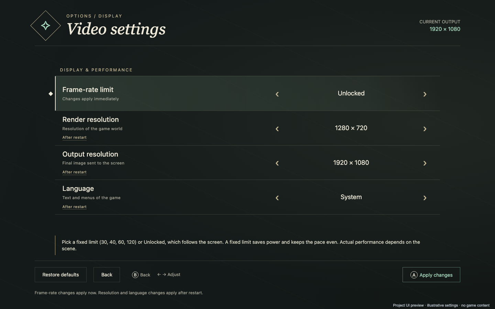

<h1 align="center">totkonandroid</h1>

<strong>TOTK · experimental Android runtime</strong>

  
  
  

  
  

  <a href="#getting-started">Getting started</a> ·
  <a href="#performance-on-the-ayn-thor">Performance</a> ·
  <a href="#video-settings">Video settings</a> ·
  <a href="#known-bugs">Known bugs</a> ·
  <a href="BUILD_ANDROID.md">Build guide</a>

A native ARM64 runtime for Android, with a Vulkan renderer and on-device shader translation. Built on [MacNativeGames](https://github.com/ly05010419/MacNativeGames) and adapted for the **AYN Thor**.

> [!IMPORTANT]
> **The AYN Thor is the reference device.** Performance figures, controls and compatibility observations describe this device. Other Android hardware is unverified. This is an experimental project with known bugs.

> [!NOTE]
> **Source only.** No APKs, game files, keys, firmware, saves or game shader caches are distributed. Supply your own game input and build locally. This unofficial project is in no way affiliated with, endorsed by, or sponsored by Nintendo.

## At a glance

| | Reference configuration |
|---|---|
| **Reference device** | **AYN Thor** |
| **SoC** | Snapdragon 8 Gen 2 · ARM64 |
| **GPU** | **Qualcomm Adreno 740** |
| **Supported game input** | TOTK **1.4.3** |
| **Observed heavier sections** | Approximately **35–40 fps** in the documented open-field session |
| **Graphics** | Vulkan · local Turnip testing |
| **Build host** | macOS ARM64 |
| **Project state** | Experimental; scene/device-specific performance and incomplete full-game coverage |

## Getting started

The target is Android 10+ ARM64 with a compatible Vulkan GPU. **The AYN Thor is the reference model**, not a promise of equivalent results on other devices.

1. Install the dependencies in the [build guide](BUILD_ANDROID.md).
2. Supply your own base NSP/XCI, 1.4.3 update and keys to `tools/import_nsp.py`, or prepare a verified extracted dump with `tools/port.py prepare`.
3. Build locally with `python tools/port.py build`.
4. Plan installation with `python tools/port.py install --serial DEVICE_SERIAL`; add `--apply` to install on that device.

The native Android shader translator can build missing variants on the device. A distributed game-derived seed or a running Mac shader bridge is not required. No in-app game importer is supplied.

## Performance on the AYN Thor

In an open-field run on the AYN Thor with **Turnip V38**, heavier sections were around **35–40 fps**. The figures below come from roughly 135 seconds of play, with frame intervals sampled in 59 groups of five frames.

| Metric | Observation |
|---|---|
| Heavier sections | Approximately 25–30 ms; around **35–40 fps** |
| Median sampled presentation interval | **21.2 ms** — approximately 47 fps reciprocal |
| p95 sampled interval | 31.0 ms |
| Maximum sampled interval | 46.1 ms |
| GPU time, heaviest section | 20.8–27.9 ms/frame |
| GPU time, quieter section | 14.9–16.4 ms/frame |
| Mean GPU utilization | 74%, GPU clock 680 MHz |
| Stability during this session | No observed crash or freeze |

These samples are not a full-game average or a sustained 47-fps claim. The reciprocal of a median interval is not average FPS. The benchmark driver differs from the later restored Turnip 27 configuration. The report does not independently establish the render resolution. Driver binaries are not bundled.

## Video settings

*Settings menu preview, rendered from the app's HTML. The values shown are examples.*

Press **L3 + R3 together** on the AYN Thor to open the menu. Use the D-pad to navigate and left/right to change a value. Select **Apply changes** and confirm with **A**. **B goes back**.

| Setting | What it changes | When it applies |
|---|---|---|
| Frame-rate limit | Presentation cap; Unlocked follows the screen | Immediately after applying |
| Render resolution | Resolution at which the game world is drawn | After restarting the game |
| Output resolution | Final image size sent to the screen | After restarting the game |
| Language | Game text/menu language override | After restarting the game |

Output resolution and internal render resolution are separate. A 1080p output alone does not establish 1080p internal rendering. See [the video-settings guide](docs/VIDEO_SETTINGS.md).

## Known bugs

| Area | Current limitation |
|---|---|
| Shader compilation | First-use translation can cause visible stalls, especially with an empty cache |
| Hardware | Devices other than the AYN Thor reference model are unverified |
| Coverage | A complete playthrough has not been tested |
| Setup | Command-line developer workflow; no in-app importer |
| Build hosts | Windows and Linux workflows are not supported by these instructions |
| Higher resolutions | Options exist; the cited benchmark does not establish a tested 1080p configuration |

<strong>Resolved issues and remaining test coverage</strong>

The black weapon/ability wheel and dark shadow blocks are fixed on the AYN Thor. Empty-cache gameplay still needs more testing.

## Testing

The Android app and native shader translator build from source. The local debug APK passes signature verification, and the filesystem, graphics-settings and renderer tests pass within the scope described in [VALIDATION.md](VALIDATION.md).

The RomFS tests cover 23 scenarios with AddressSanitizer and UndefinedBehaviorSanitizer. GitHub Actions runs the source check, RomFS tests and graphics-settings tests on each push.

Build and host tests don't replace gameplay testing. A complete playthrough, empty-cache behavior and other devices still need more coverage.

## Project layout

| Directory | Contents |
|---|---|
| `android/` | Android loader, host services, Vulkan backend, project-authored UI and tests |
| `games/totk/` | Inherited runtime, graphics implementation and preparation code |
| `vendor/` | Shader-translator dependency source |
| `tools/` | Import, build/preparation, install and publication helpers |
| `docs/` | Reference-device and video-settings guides, UI preview and upstream technical notes |

## Acknowledgements

This project is **in no way affiliated with, endorsed by, or sponsored by Nintendo**.

**Thank you, Nintendo, for this magnificent game.**

## Source, licensing and contributions

Preserve [LICENSE](LICENSE), [THIRD_PARTY_NOTICES.md](THIRD_PARTY_NOTICES.md) and all dependency notices. The retained code is licensed source; no license to game or firmware content is granted. See [SOURCE_ORIGIN.md](SOURCE_ORIGIN.md) for credits and source details.

The badges and menu preview are project-authored documentation assets. [README.upstream.md](README.upstream.md) describes the inherited Apple implementation and is retained for attribution and technical reference.

For bug reports, include your device, game version, driver, settings and reproduction steps. **Always state whether you are using the AYN Thor reference configuration.** See [CONTRIBUTING.md](CONTRIBUTING.md). Never attach APKs, game data, keys, firmware, saves or shader caches to commits, issues or releases.
