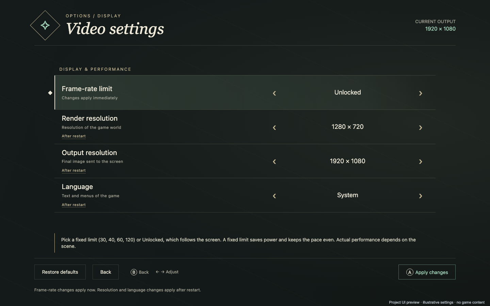

# Video settings on the AYN Thor

**Reference device: AYN Thor.** The menu is project-authored HTML displayed in an Android WebView, with native hooks for reading and saving settings.

## What the screenshot shows

This is a browser capture of the exact menu HTML included in this repository, using illustrative values supplied by a small mock of the Android bridge. It is not a capture from a running game or a performance measurement. No game image, texture, character, official logo or firmware data is used. The small preview caption is added only by the documentation capture script.

Regenerate on macOS with Chrome installed using `python tools/capture_settings_preview.py`. Regeneration can change font/rendering bytes, so visually review the result and explicitly update the approved image digest in tools/publication_guard.py before publication. No screenshot is captured from a personal browser session; a temporary isolated Chrome profile is used.

## Open and navigate

Press L3 + R3 together on the AYN Thor. The implementation recognizes fresh presses within 300 ms. The private environment override `TOTK_VIDEO_MENU=0` disables the shortcut. Start/+ keeps its game function.

Use the D-pad to choose a row or action and left/right to adjust the selected setting. Select Apply changes and press A to save. B returns; unsaved changes trigger a confirmation. Restore defaults changes the draft and still requires Apply changes to save.

## Rendering versus output

Render resolution controls the internal drawing resolution of the game image. Output resolution controls the final image size sent to the display. They can differ: a 1920 × 1080 output can present an image rendered at 1280 × 720. Increasing output alone does not establish native 1080p rendering. Resolution changes require restarting the game after saving.

## Frame-rate limits

The menu offers 30, 40, 60 and 120 FPS plus Unlocked. This selects a cap, not a performance guarantee. Scene complexity, shader compilation, driver behavior and GPU workload determine the achieved rate. Applying an FPS choice changes pacing immediately; resolution changes wait until restart.

## Language

Language is a separate game-text/menu override. Select the desired language, apply it and restart the game. This setting is distinct from the language of the settings panel.
